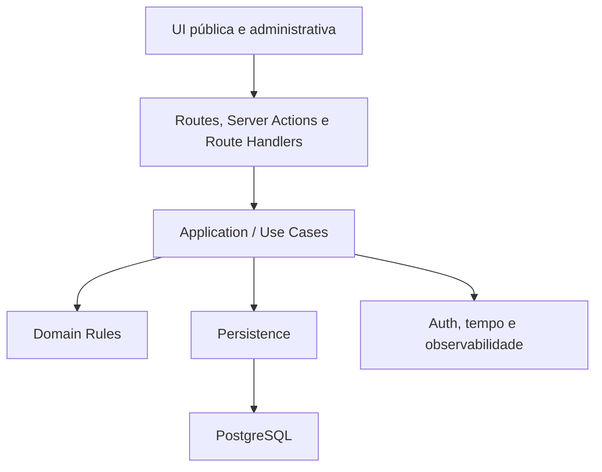

# BARBER_ARCHITECTURE_v1

## Controle do documento

| Campo | Valor |
|---|---|
| Produto | Barber SaaS — núcleo genérico de agendamento |
| Fase | FASE 4 — Technical Spikes |
| Versão | 1.0 |
| Data | 23 de agosto de 2026 |
| Status | **TECHNICAL_SPIKES_COMPLETE — ARCHITECTURE_READY_FOR_SPRINT_0** |
| Checkpoint | SPK-001 a SPK-006 concluídos com PASS; sete ADRs ACCEPTED; ADR-008 PROPOSED sem bloquear Sprint 0 |
| Fontes | BARBER_PRODUCT_DISCOVERY_v1, BARBER_PRD_v1, BARBER_UX_SPEC_v1 e PRODUCT_DECISION_GENERIC_SCHEDULING_v1 |
| Documentos complementares | BARBER_DATA_MODEL_v1 e BARBER_ARCHITECTURE_DECISIONS_v1 |

## 1. Resumo executivo

O MVP será implementado como um **monólito modular web**, executado em runtime Node.js, com Next.js no frontend e no backend da aplicação e PostgreSQL como fonte de verdade. Supabase fornecerá PostgreSQL gerenciado e autenticação administrativa. O navegador nunca acessará diretamente as tabelas de domínio.

A arquitetura mantém um único deploy e um único banco, mas separa claramente:

- UI e rotas;
- casos de uso da aplicação;
- regras de domínio;
- persistência;
- integrações de infraestrutura.

As regras críticas não dependerão do frontend. Disponibilidade será calculada sob demanda; horários disponíveis não serão materializados como milhares de linhas. A confirmação revalidará as regras e criará uma ocupação protegida por constraint do PostgreSQL. Essa garantia funciona mesmo com duas instâncias da aplicação concorrendo.

`Business` será raiz conceitual de escopo, com exatamente uma instância operacional no MVP. A arquitetura propõe `business_id` seletivo nas entidades que pertencem diretamente ao negócio e derivação por relacionamento em entidades filhas. Isso prepara o modelo sem criar multi-tenancy, onboarding, equipe, planos ou billing.

## 2. Restrições arquiteturais obrigatórias

### 2.1 Limites do MVP

- Edmar é o único piloto.
- Existe um único `Business` operacional.
- Existe um único administrador autenticado.
- Existe um único profissional operacional implícito.
- Existe uma única unidade implícita.
- A capacidade simultânea é um.
- Não existem `Professional`, `Location`, `Tenant`, `Organization`, `Workspace`, `Membership`, `Plan` ou `Subscription`.
- Não existe cadastro público de negócios nem roteamento multiempresa.

O schema poderá ser exercitado com dois negócios em testes isolados de escopo, mas a aplicação de produção não terá endpoint, tela ou fluxo para criar uma segunda instância. Isso não implementa multi-tenancy; apenas permite provar que o escopo seletivo não mistura dados.

### 2.2 Restrições de solução

- Um único repositório e um único deploy de aplicação.
- Um único PostgreSQL como autoridade transacional.
- Sem microserviços, event sourcing, filas, cache distribuído ou jobs obrigatórios para o ciclo central.
- Sem regra comercial duplicada entre cliente e servidor.
- Sem acesso direto do browser às tabelas do domínio.
- Sem depender do timezone do dispositivo.
- Sem confirmação otimista de reserva antes do commit.

## 3. Stack final recomendada

| Camada | Escolha | Observação |
|---|---|---|
| Linguagem | TypeScript em modo estrito | Tipos não substituem validação de entrada |
| Runtime | Node.js 24 LTS | Versão exata de patch será fixada na Sprint 0 |
| Framework | Next.js estável com App Router | Runtime Node para operações de banco; não Edge |
| UI | React compatível com a versão fixada do Next.js | Server Components por padrão; Client Components somente quando interatividade exigir |
| Estilo | Tailwind CSS | Tokens e direção visual serão aprovados antes da replicação em massa |
| Validação | Zod | Schemas na fronteira de entrada e saída; invariantes continuam no domínio e no banco |
| Banco | PostgreSQL gerenciado pelo Supabase | Fonte de verdade para dados e concorrência |
| Autenticação | Supabase Auth com sessão SSR em cookies | Somente administrador |
| Acesso a dados | Drizzle ORM + driver `pg` + SQL parametrizado localizado | Drizzle para consultas comuns; SQL explícito para recursos avançados do PostgreSQL |
| Migrations | SQL final versionado em `supabase/migrations` | Supabase CLI é a única autoridade de aplicação; Drizzle Kit apenas pode gerar SQL candidato; nunca `push` em produção |
| Tempo | Temporal com polyfill fixado enquanto necessário | Regras críticas executadas no servidor com timezone IANA explícito |
| Testes | Vitest, Testing Library e Playwright | Integração de banco usa PostgreSQL real |
| CI | GitHub Actions | Lint, tipos, testes, build e verificação de migrations |
| Deploy | Vercel + projeto Supabase separado para produção | Preview nunca usa dados de produção |
| Erros | Logs estruturados da aplicação e Sentry sem Session Replay | Scrubbing de PII e tokens obrigatório |
| Pacotes | npm com lockfile | Dependências e runtime fixados na Sprint 0 |

Versões de bibliotecas não flutuarão por `latest` em CI ou produção. A FASE 3 congela as escolhas; a Sprint 0 registrará versões exatas, lockfile e política de atualização.

## 4. Visão da aplicação



O diagrama mostra direção de dependência, não processos separados. UI, casos de uso e adaptadores vivem na mesma aplicação Next.js.

## 5. Responsabilidades por boundary

### 5.1 UI

Responsável por:

- renderização mobile-first;
- coleta de entrada;
- feedback de loading, erro, conflito e sucesso;
- validações de conveniência;
- preservação de rascunho quando seguro;
- acessibilidade e confirmação de ações destrutivas.

Não é responsável por:

- autorizar operações;
- decidir disponibilidade final;
- impedir double booking;
- aplicar transições de estado;
- calcular snapshots financeiros;
- interpretar timezone crítico.

### 5.2 Delivery: rotas e handlers

Responsável por:

- converter HTTP/formulário em comandos e consultas;
- extrair sessão, credencial por token, idempotency key e correlation ID;
- validar forma da entrada com Zod;
- impor, no servidor, teto técnico pequeno por request de disponibilidade, sem confundi-lo com o horizonte comercial do `Business`;
- mapear resultados para códigos e mensagens estáveis;
- definir headers de cache, segurança e privacidade.

Server Components podem chamar consultas da aplicação diretamente no servidor. Mutações administrativas podem usar Server Actions; endpoints públicos, troca de token e operações que precisam de contrato HTTP/idempotência explícita usam Route Handlers. Ambos chamam os mesmos casos de uso.

### 5.3 Application / Use Cases

Responsável por orquestrar uma intenção completa:

- `ListPublicServices`;
- `GetAvailableDates`;
- `GetAvailableTimes`;
- `CreatePublicAppointment`;
- `CreateManualAppointment`;
- `CancelAppointment`;
- `RescheduleAppointment`;
- `CompleteAppointment`;
- `MarkNoShow`;
- `ConfigureBusiness`;
- `ConfigureService`;
- `ConfigureAvailability`;
- `CreateBlockedPeriod`.

Cada mutação crítica:

1. resolve o `BusinessScope` no servidor;
2. autentica ou valida a capability do cliente;
3. valida o comando;
4. inicia transação quando houver mais de uma escrita ou leitura que participa da decisão;
5. aplica regra de domínio;
6. persiste efeito, histórico e recibo de idempotência na mesma transação;
7. converte conflitos esperados em resultado de negócio, nunca em sucesso falso.

### 5.4 Domain Rules

Funções e tipos sem dependência de Next.js, React ou Supabase concentram:

- estados e transições do agendamento;
- políticas de cancelamento e remarcação;
- snapshots do serviço;
- transformação de disponibilidade em intervalos;
- validação de faixas e exceções;
- cálculo de duração e intervalo ocupado;
- conversões locais/UTC por contrato explícito;
- decisões de preço após remarcação quando forem aprovadas.

Não será criada uma camada abstrata para cada tabela. Um módulo só recebe entidade, caso de uso ou repositório próprio quando existir regra ou fronteira útil.

### 5.5 Persistence

Responsável por:

- queries tipadas e parametrizadas;
- transações;
- locks de linha necessários;
- tratamento de códigos de erro do PostgreSQL;
- constraints avançadas e migrations SQL;
- mapeamento entre linhas e modelos de domínio;
- exigir `BusinessScope` em operações pertencentes ao negócio.

SQL manual fica localizado em repositórios e migrations, com testes de integração. UI e casos de uso não contêm SQL.

### 5.6 Infrastructure

Responsável por:

- cliente SSR do Supabase Auth;
- verificação da sessão e recuperação de acesso;
- relógio injetável;
- Temporal/timezone;
- geração, hash e rotação de tokens;
- logs, métricas e error tracking;
- configuração de ambiente e segredos.

## 6. Módulos do monólito

| Módulo | Responsabilidade |
|---|---|
| Business | identidade pública, timezone, publicação e escopo singleton |
| Services | catálogo, preço, duração, ativação e snapshots |
| Availability | semana, faixas, intervalos, exceções, bloqueios, antecedência e geração de candidatos |
| Appointments | reserva, estados, cancelamento, remarcação, ocupação e histórico |
| Customers | identificação mínima por nome/WhatsApp e histórico básico |
| Admin Access | sessão e autorização do único administrador |
| Customer Access | token-capability, troca por sessão curta, rotação e revogação |
| Shared Infrastructure | banco, tempo, validação, idempotência e observabilidade |

Não haverá módulo `Professional` ou `Location`. A capacidade unitária pertence ao calendário operacional do `Business`.

## 7. Business e resolução de escopo

### 7.1 Regra operacional

Produção contém uma instância operacional de `Business`. Não existe criação, seleção ou troca de negócio em runtime.

### 7.2 Resolução pública

O servidor resolve o único negócio ativo. O cliente não envia um `business_id` confiável. Se a consulta encontrar zero ou mais de um negócio ativo, o sistema falha de forma segura, registra erro de configuração e não publica agenda ambígua.

### 7.3 Resolução administrativa

A sessão do Supabase fornece o identificador autenticado. A autorização compara esse identificador ao administrador associado ao `Business`. Middleware/proteção de rota melhora UX, mas o caso de uso repete a verificação antes de acessar dados.

### 7.4 Preparação seletiva

Entidades que são raízes de dados do negócio carregam `business_id`; filhos o derivam por foreign key e join. `Appointment` carrega `business_id` mesmo sendo relacionável a serviço e cliente porque ele participa de autorização, agenda, constraints e índices críticos. Composite foreign keys impedem que serviço, cliente e agendamento de negócios diferentes sejam combinados.

## 8. Disponibilidade

### 8.1 Precedência determinística proposta

1. Resolver `Business`, timezone, política, serviço ativo e data local.
2. Aplicar horizonte e antecedência à data/instantes candidatos.
3. Ler a regra semanal e suas múltiplas faixas de trabalho.
4. Se existir exceção da data:
   - `CLOSED` substitui toda a regra semanal por indisponibilidade;
   - `REPLACE` substitui integralmente as faixas semanais pelas faixas especiais.
5. Quando a regra semanal continuar válida, subtrair intervalos recorrentes.
6. Gerar horários iniciais na cadência configurada, ancorados no início de cada faixa efetiva.
7. Para cada início, calcular intervalo do serviço e intervalo de ocupação conforme duração e semântica de buffer aprovada.
8. Rejeitar candidato cujo intervalo completo não caiba em uma única faixa efetiva.
9. Subtrair `BlockedPeriod` ativo e ocupações de agendamentos já persistidas.
10. Converter horários locais válidos em instantes e ordenar cronologicamente.

Bloqueio e ocupação sempre vencem uma faixa aberta. Uma exceção nunca remove uma reserva existente.

### 8.2 Algoritmo conceitual

`Service + local date` produz:

1. contexto do negócio;
2. janelas locais efetivamente abertas;
3. candidatos de início;
4. intervalos completos de serviço/ocupação;
5. conversão para UTC;
6. remoção de conflitos;
7. lista ordenada de horários públicos.

A lista é uma fotografia informativa. A confirmação executa novamente as regras em transação e depende da constraint final de ocupação.

O comando de confirmação carrega a versão e os dados revisados do `Service`. Se nome, duração, preço ou atividade mudarem desde a revisão, a operação não aceita silenciosamente os novos valores: retorna `SERVICE_CHANGED`, não cria reserva e exige nova revisão pelo cliente.

### 8.3 O que não será armazenado

Não serão persistidas linhas para cada horário disponível. Persistem apenas regras, exceções, bloqueios e ocupações reais.

Também não haverá cache de aplicação no MVP. Consultas de disponibilidade, agenda e gerenciamento por token são dinâmicas e usam `no-store`. Identidade pública e catálogo podem usar revalidação/invalidação explícita, desde que uma edição administrativa não permaneça indefinidamente desatualizada.

### 8.4 Limite técnico por request

Consultas públicas de disponibilidade não aceitam intervalos arbitrários fornecidos pelo cliente. O boundary valida com Zod, no servidor, um teto absoluto pequeno por request, na ordem de grandeza de aproximadamente um mês. O valor exato será congelado na Sprint 0 após load test.

Esse teto é de transporte e proteção operacional: não reduz `booking_horizon_days`. Quando o horizonte do `Business` for maior, a UI o percorre em páginas ou chunks que respeitem o limite absoluto.

### 8.5 Lacuna identificada: cadência de início

O PRD não define se horários começam a cada 5, 10, 15, 30 ou outro número de minutos. Isso altera o produto e não pode ser hardcoded silenciosamente.

A arquitetura reserva um parâmetro simples `slot_step_minutes` no `BusinessSchedulingPolicy`, mas seu valor inicial e se será editável no painel precisam de aprovação antes da implementação da disponibilidade. Até lá, nenhum valor é regra aprovada.

### 8.6 Buffer ainda aberto

O domínio manipulará separadamente:

- intervalo mostrado do serviço;
- intervalo ocupado para impedir conflito.

Assim, a decisão posterior entre buffer após o serviço ou antes/depois altera um único cálculo e não o mecanismo de concorrência. Nenhuma semântica final é congelada neste documento.

## 9. Concorrência e integridade de agenda

### 9.1 Unidade de capacidade

Uma tabela técnica `ScheduleOccupancy` representa intervalos que consomem a capacidade única do negócio. Agendamentos confirmados e bloqueios ativos geram uma ocupação nessa tabela. Não é `Professional`, `Location` ou um recurso genérico; é uma proteção de persistência para o calendário singleton.

### 9.2 Constraint final

O PostgreSQL mantém uma exclusion constraint GiST sobre:

- igualdade de `business_id`;
- sobreposição do intervalo UTC `[início, fim)`;
- somente ocupações não liberadas.

O formato meio-aberto permite um atendimento iniciar exatamente quando o intervalo ocupado anterior termina. A extensão `btree_gist` fornece igualdade de UUID junto com ranges temporais.

### 9.3 Confirmação concorrente

1. A e B veem 14:00.
2. Cada requisição abre sua transação e revalida as regras.
3. Ambas tentam criar uma ocupação 14:00–fim.
4. O PostgreSQL permite somente uma; a outra espera e recebe conflito de exclusão.
5. A transação vencedora cria agendamento, evento, token e recibo idempotente.
6. A perdedora é revertida integralmente e recebe conflito de horário.

Nenhum `SELECT` anterior é tratado como garantia.

### 9.4 Mudança de configuração concorrente

Reservas adquirem lock compartilhado na versão de disponibilidade do `Business` durante leitura e confirmação. Alterações de jornada, exceção, política ou timezone adquirem lock exclusivo, verificam compromissos afetados e incrementam a versão. Isso evita que uma reserva seja confirmada com regras que mudaram no meio da transação sem serializar reservas comuns entre si.

Enquanto a política de “salvar mesmo com conflitos” não for aprovada, alterações que invalidariam reservas futuras falham sem persistir e retornam a lista de conflitos à UI.

### 9.5 Ordem global de locks

Quando uma mesma transação precisar tanto de lock de disponibilidade/configuração quanto de lock de `Appointment`, deverá adquirir primeiro o lock de escopo/configuração e depois o lock do `Appointment`. Booking e remarcação usam locks compartilhados de disponibilidade; por isso o deadlock determinístico aventado na revisão externa não foi confirmado. A ordem global permanece obrigatória como prevenção e foi validada pelo SPK-001, inclusive com deadlocks deliberados por inversão.

### 9.6 Ocupação após estados terminais

- Cancelamento libera a ocupação na mesma transação por mudança de estado e preenchimento de `released_at`; a aplicação nunca usa `DELETE` para liberar capacidade.
- Remarcação move ou substitui o intervalo ativo na mesma transação sem apagar a ocupação para simular liberação.
- Conclusão e no-show preservam a ocupação histórica; como o período fica no passado, não afeta horários futuros.

A role de runtime não terá privilégio `DELETE` em `ScheduleOccupancy`. Purge histórico está fora do MVP. O SPK-001 validou o `REVOKE DELETE` e a defesa adicional pelo trigger diferível owner/occupancy; um segundo trigger `BEFORE DELETE` dedicado não é necessário.

Isso também evita liberar acidentalmente um horário futuro se um estado terminal for marcado antes do tempo enquanto a regra QP-006 ainda está aberta.

## 10. Idempotência e respostas incertas

### 10.1 Contrato

Toda mutação crítica recebe uma idempotency key gerada pelo cliente para uma intenção:

- criar agendamento público;
- criar agendamento manual;
- cancelar;
- remarcar;
- concluir;
- marcar no-show;
- criar bloqueio.

A chave é combinada a operação, `Business` e `request_fingerprint` do comando. O fingerprint não é hash de serialização JSON arbitrária: o pipeline obrigatório é **comando validado e normalizado → representação canônica versionada → serialização determinística → SHA-256**. A mesma chave com intenção diferente é rejeitada.

### 10.2 Persistência atômica

O recibo idempotente e o efeito de negócio são gravados na mesma transação. Repetição da mesma intenção retorna o resultado já confirmado; não repete evento, ocupação ou transição.

Para criação pública, a resposta contém o link secreto. O token bruto não será persistido em texto. A proposta é manter, no recibo idempotente e por prazo curto, um envelope cifrado da resposta suficiente para repetir a confirmação após timeout. A viabilidade e a gestão da chave serão validadas em spike antes da implementação.

### 10.3 Comportamentos

| Situação | Resultado |
|---|---|
| Duplo clique com mesma chave | uma operação e mesma resposta |
| Retry após timeout | consulta recibo e devolve estado confirmado |
| Mesma chave, payload diferente | conflito de idempotência |
| Cancelamento já cancelado | sucesso idempotente, sem novo evento |
| Remarcação repetida com mesma chave | devolve o resultado original |
| Segunda remarcação com outra chave e versão antiga | conflito de versão; não altera horário atual |
| Banco falha antes do commit | nenhum efeito; retry pode executar |
| Banco confirma e resposta se perde | retry recupera recibo |

## 11. Remarcação atômica

Uma remarcação opera sobre o mesmo `Appointment`:

1. validar token/sessão, política e idempotência;
2. iniciar transação;
3. adquirir lock compartilhado de disponibilidade/configuração;
4. bloquear a linha do agendamento (`FOR UPDATE`);
5. verificar estado `CONFIRMED` e versão esperada;
6. recalcular disponibilidade do novo período;
7. atualizar a mesma `ScheduleOccupancy` para o novo intervalo;
8. deixar a exclusion constraint validar o novo conflito;
9. atualizar snapshots conforme a futura regra de preço aprovada;
10. incrementar versão e registrar `AppointmentEvent` com antes/depois;
11. gravar recibo idempotente e confirmar.

Se qualquer passo falhar, toda a transação volta ao estado anterior, inclusive a ocupação original. Duas remarcações concorrentes são serializadas pelo lock da linha; a segunda observa versão diferente e não sobrescreve a primeira.

## 12. Tempo e timezone

### 12.1 Representação

- `Business.timezone` guarda identificador IANA obrigatório.
- Jornada recorrente guarda dia da semana e hora local sem offset.
- Exceções guardam data local do negócio e faixas locais.
- Agendamentos guardam instantes UTC (`timestamptz`) para início, fim do serviço e ocupação.
- O agendamento preserva timezone, data/hora local e offset usados na confirmação para histórico estável.
- API transmite instantes em ISO 8601 com `Z` ou offset explícito e datas locais no formato próprio, nunca strings ambíguas.

### 12.2 Conversão

Somente o servidor converte regra local em instante usando Temporal e timezone do `Business`. O timezone do browser pode formatar preferências não críticas, mas nunca determina disponibilidade, política ou persistência.

### 12.3 DST

- Horário local inexistente não gera slot e nunca é ajustado silenciosamente.
- Horário local ambíguo gera deterministicamente a primeira ocorrência cronológica no MVP.
- Após confirmação, o instante UTC é inequívoco.
- Testes usam timezones reais com transições, não apenas `America/Sao_Paulo`.

### 12.4 Antecedência e fronteiras

- Antecedência mínima é duração exata em minutos a partir do relógio do servidor.
- Horizonte máximo é quantidade de dias de calendário do `Business`, avaliada pela data local.
- Um candidato precisa começar depois do instante mínimo e pertencer a uma data dentro do horizonte inclusivo configurado.
- Horário cujo início já passou é inválido, ainda que a página antiga o mostre.

### 12.5 Mudança de timezone

No MVP, mudar timezone com agendamento confirmado futuro é bloqueado e apresentado como conflito. Sem compromissos futuros, a alteração:

- incrementa a versão de disponibilidade;
- reinterpreta regras semanais e futuras exceções locais no novo timezone;
- não reescreve instantes nem snapshots históricos.

Migração assistida de reservas entre timezones é pós-MVP.

## 13. Autenticação e autorização administrativa

### 13.1 Autenticação

- Supabase Auth com um usuário administrativo.
- Login por e-mail e senha no MVP.
- Recuperação por fluxo oficial de redefinição de senha.
- Fluxo oficialmente suportado pelo `@supabase/ssr`, com sessão baseada em cookies; esta decisão não promete `HttpOnly` no modelo padrão.
- Cookies com `Secure` em produção e `SameSite` adequado ao fluxo validado.
- Cliente Supabase criado por request; nunca singleton compartilhado entre usuários.
- Respostas autenticadas protegidas contra cache compartilhado.
- Autenticação e autorização verificadas novamente no servidor.
- Recuperação, logout e refresh serão validados no SPK-005.

Um modelo futuro server-only/`HttpOnly` exigirá decisão arquitetural separada; não faz parte desta proposta.

### 13.2 Autorização

- O identificador autenticado deve corresponder ao `admin_auth_user_id` do `Business`.
- Toda consulta e mutação administrativa recebe `BusinessScope` produzido no servidor.
- Middleware não é controle final; o caso de uso autoriza novamente.
- Não existe RBAC, permissões, convite ou equipe.

### 13.3 CSRF

- Server Actions mantêm verificação de origem suportada pelo framework.
- Route Handlers autenticados validam `Origin`/host e usam cookies SameSite.
- Mutações não são executadas por GET.
- Formulários possuem idempotência além da proteção CSRF.

## 14. Token de gerenciamento do cliente

### 14.1 Natureza

O token é uma capability: quem o possui pode exercer apenas ações permitidas sobre um único agendamento. Não representa identidade geral do cliente.

### 14.2 Ciclo proposto

- Gerado no servidor por CSPRNG com pelo menos 256 bits.
- Codificado em base64url sem identificador sequencial.
- O banco guarda somente hash com pepper e metadados de emissão; nunca o token bruto.
- Lookup usa o hash indexado e retorna erro neutro para inexistente, revogado ou inválido.
- Rotação cria novo token e revoga o anterior atomicamente.
- Cancelado, concluído e no-show continuam consultáveis em modo somente leitura enquanto o token for válido.
- Revogação ocorre em rotação, suspeita de vazamento, anonimização ou encerramento da retenção.

### 14.3 URL e troca por sessão curta

A opção recomendada é colocar o token no fragmento do link, que não é enviado em request/referrer. Uma tela mínima troca o token por cookie de capability curto, `HttpOnly` e `Secure`, remove o fragmento do histórico visível e passa a usar URL limpa. Essa solução exige spike porque caching, logs de plataforma, refresh e recuperação precisam ser validados no Next.js/Vercel.

Páginas de gerenciamento usam `Cache-Control: private, no-store`, `Referrer-Policy: no-referrer`, nenhuma integração de analytics de terceiros e CSP restritiva.

### 14.4 Perda do link

Não existe recuperação pública por nome/WhatsApp no MVP. O administrador, após verificar o cliente pelo canal operacional existente, pode rotacionar e entregar novo link. Envio automático continua pós-MVP.

## 15. Threat model proporcional

| Risco | Controle principal | Risco residual |
|---|---|---|
| IDOR em agendamento | capability de alta entropia, escopo único, erro neutro e autorização em cada ação | token roubado concede acesso até revogação |
| Enumeração/brute force | 256 bits, hash indexado, rate limit e respostas uniformes | abuso distribuído ainda pode gerar custo |
| XSS | escaping padrão, validação, CSP, dependências controladas e ausência de HTML arbitrário | vulnerabilidade de dependência |
| CSRF admin/cliente | SameSite adequado, Origin/host, POST e cookies protegidos conforme cada fluxo | navegador/integração fora do padrão exige teste |
| SQL injection | Drizzle e SQL parametrizado; proibir concatenação de entrada | SQL manual mal revisado |
| Double booking | exclusion constraint na ocupação e transação | bug de persistência que omita ocupação; coberto por constraint trigger/teste |
| Spam/fake booking | rate limit de mutação, honeypot discreto, limites de payload e monitoramento | sem verificação de WhatsApp ainda existe reserva falsa |
| Vazamento de WhatsApp | server-only data, autorização, logs redigidos e acesso mínimo | comprometimento do banco/aplicação |
| Vazamento de token | fragment exchange, hash no banco, no-store, no-referrer e redaction | compartilhamento voluntário ou dispositivo comprometido |
| Sessão admin roubada | cookies seguros, TLS, expiração, rotação e logout | dispositivo do administrador comprometido |
| Secrets | variáveis por ambiente, sem exposição ao cliente/repo, rotação | acesso indevido ao provedor |
| Acesso cruzado futuro | BusinessScope, composite FKs, índices/constraints escopados e testes com dois negócios | query manual fora do repositório |
| Logs sensíveis | allowlist de campos e scrubbing | mensagem de erro de dependência não filtrada |

Rate limit precisa funcionar entre instâncias. A primeira opção é controle na borda da hospedagem; se indisponível no plano escolhido, um fallback persistente e pseudonimizado no PostgreSQL será avaliado em spike. Não será usado contador em memória como proteção principal.

## 16. Privacidade

### 16.1 Dados necessários

- nome do cliente;
- WhatsApp normalizado;
- serviço, data, horário e histórico operacional;
- origem e ator de alterações;
- identidade administrativa no provedor de Auth.

Não coletar e-mail do cliente, senha, aniversário, documento, endereço residencial ou dados sensíveis de segmento.

### 16.2 Armazenamento e uso

- WhatsApp normalizado em formato internacional para busca operacional.
- Nome e WhatsApp preservados como snapshot no agendamento enquanto a política de retenção exigir.
- Criptografia gerenciada em trânsito e repouso; criptografia de campo não é proposta inicialmente porque prejudica busca e adiciona gestão de chaves, mas pode ser reavaliada após threat model de produção.
- Dados pessoais não entram em URLs, eventos analíticos ou mensagens de exceção.

### 16.3 Retenção candidata, ainda não jurídica

| Dado | Candidato técnico |
|---|---|
| Idempotência e envelope de resposta | 24–72 horas, com exclusão do conteúdo cifrado o mais cedo possível |
| Logs de aplicação | 30 dias, sujeito ao provedor e sem PII direta |
| Tokens revogados | hash mínimo até expirar necessidade de auditoria; nunca bruto |
| Nome/WhatsApp e histórico | até 24 meses após última interação, depois anonimização, pendente de aprovação |
| Backups | conforme plano Supabase, com retenção e teste de restauração documentados |

Anonimização substitui PII do cliente e dos snapshots quando permitido, preservando estatística e integridade temporal. Exclusão física em cascata de histórico não será oferecida sem política aprovada.

## 17. Observabilidade mínima

### 17.1 Eventos estruturados

Registrar por allowlist:

- timestamp UTC;
- ambiente e versão/release;
- correlation ID;
- operação;
- resultado: sucesso, validação, conflito, não autorizado ou falha;
- duração;
- identificadores internos de `Business` e `Appointment` quando necessários;
- SQLSTATE/constraint conhecida sem query completa;
- stack trace server-side redigida.

Nunca registrar:

- token bruto, fragmento ou cookie;
- senha, segredo ou connection string;
- WhatsApp integral;
- nome do cliente;
- payload completo de formulários.

### 17.2 Sinais essenciais

- tentativa/sucesso/conflito/falha de booking;
- exclusion constraint acionada;
- tentativa e falha de remarcação;
- cancelamento idempotente;
- falha de autenticação e autorização;
- erro de banco e timeout;
- alteração de timezone bloqueada;
- configuração que conflita com reserva.

Alertas iniciais: pico de erros server-side, falhas de banco, falhas repetidas de auth e qualquer violação inesperada de integridade. Conflito normal de horário é métrica de negócio, não erro fatal.

## 18. Estratégia de testes

| Nível | Escopo |
|---|---|
| Unit | regras puras de disponibilidade, intervalos, snapshots, estados, política, tempo e validação |
| Component | formulários, erros, foco, estados vazios e acessibilidade básica |
| Integration | casos de uso com adaptadores reais ou controlados; Auth boundary e mapeamento de erros |
| Database integration | migrations reais, constraints, transações, locks, composite FKs, índices e SQL avançado |
| Concurrency | múltiplas conexões/processos disputando booking, bloco, idempotência e remarcação |
| E2E | jornadas P0 e P1 prioritárias em navegador mobile/desktop |

Casos obrigatórios:

- múltiplas faixas e intervalos;
- duração e buffer nos limites;
- exceção `CLOSED` e `REPLACE`;
- bloqueio parcial e total;
- timezone, DST inexistente e ambíguo;
- snapshots após edição de serviço;
- duas reservas simultâneas;
- reserva versus bloqueio;
- duplo clique e retry após timeout;
- fingerprints equivalentes após normalização e fingerprints distintos para intenções diferentes;
- rejeição server-side de intervalos de disponibilidade acima do teto e paginação sem reduzir o horizonte do Business;
- duas remarcações concorrentes;
- rollback de remarcação;
- cancelamento repetido;
- estados terminais;
- sessão expirada;
- IDOR/BusinessScope;
- token inválido, revogado e rotacionado;
- redaction de logs.

SQLite e mocks não substituem testes de constraints PostgreSQL. Teste de concorrência usa conexões reais e barreiras determinísticas, não `sleep` como única sincronização.

## 19. Deploy e ambientes

### 19.1 Ambientes

| Ambiente | Aplicação | Banco/Auth | Dados |
|---|---|---|---|
| Development | local | Supabase local | seed sintético |
| Test/CI | runner GitHub | PostgreSQL efêmero com extensões; Supabase local quando Auth for necessário | fixtures descartáveis |
| Preview | Vercel Preview | projeto não produtivo compartilhado ou branch isolada quando disponível | somente dados sintéticos |
| Production | Vercel | projeto Supabase exclusivo | dados reais |

Preview nunca recebe secrets ou banco de produção. Mudanças destrutivas de schema não serão testadas contra dados reais.

### 19.2 Conexões

- Runtime serverless usa pooler em modo transação e driver configurado sem prepared statements nomeados.
- Supabase CLI é o único mecanismo que aplica migrations em qualquer ambiente.
- Arquivos finais revisados pertencem a `supabase/migrations`; Drizzle Kit pode gerar apenas SQL candidato para o schema da aplicação.
- Configuração do Drizzle limita seu escopo ao schema da aplicação. Migrations da aplicação não gerenciam, removem ou recriam schemas/tabelas administrados pelo Supabase, incluindo `auth` e `storage`.
- Migrations usam conexão apropriada para DDL, separada do pool transacional de runtime; `drizzle-kit push` é proibido em produção.
- Pool pequeno por instância; limites validados em carga básica.
- Operações críticas rodam em runtime Node e mantêm a transação em uma única conexão.

### 19.3 Pipeline

Em pull request:

1. instalação reproduzível;
2. lint e formatação;
3. typecheck;
4. unit/component;
5. banco efêmero + migrations + integration/concurrency;
6. build;
7. E2E essencial quando o ambiente estiver disponível.

Produção:

- backup verificado antes de migration relevante;
- migration forward-only revisada;
- deploy compatível com schema anterior quando rollout exigir;
- smoke test;
- rollback de aplicação sem presumir rollback destrutivo do banco.

## 20. Estrutura futura do repositório

```text
src/
  app/
    (public)/
    admin/
    api/
  components/
    ui/
    public/
    admin/
  modules/
    business/
    services/
    availability/
    appointments/
    customers/
  shared/
    validation/
    errors/
    types/
  infrastructure/
    db/
    auth/
    time/
    observability/
supabase/
  migrations/
tests/
  integration/
  database/
  concurrency/
  e2e/
```

Dentro de cada módulo, `domain`, `application` e `persistence` só aparecem quando o módulo realmente possui esses três tipos de código. Não serão criadas pastas vazias ou uma interface para cada classe.

## 21. Princípio de qualidade visual para implementação futura

Esta arquitetura não congela o visual. Registra somente que:

- a IA não inventará uma UI SaaS genérica;
- gradientes, cards, badges, métricas, ícones e animações só entram com função clara;
- a direção é mobile-first e a hierarquia visual será intencional;
- textos serão curtos e naturais;
- tokens e componentes visuais serão definidos antes da implementação em massa;
- frames-chave receberão aprovação visual antes de replicação;
- Codex implementará a direção aprovada, sem redesenhá-la autonomamente.

## 22. Auto-revisão adversarial

| Cenário | Defesa | Estado inconsistente possível? |
|---|---|---|
| Dois clientes reservam simultaneamente | exclusion constraint em `ScheduleOccupancy` | não, se toda reserva cria ocupação na mesma transação |
| Retry após timeout | recibo idempotente atômico | não; envelope AES-256-GCM de TTL curto validado pelo SPK-003 recupera o token/link sem duplicar efeito |
| Double click | mesma idempotency key e botão bloqueado | não |
| Duas remarcações concorrentes | lock da linha + versão + constraint | não |
| Admin bloqueia período com reserva | mesma tabela de ocupação rejeita sobreposição | não; bloco não é salvo |
| Serviço muda após reserva | snapshots no Appointment | não |
| Business muda timezone | bloqueio quando há compromisso futuro | não; alteração sem compromissos reinterpreta regras conscientemente |
| Token roubado | capability limitada, rotação e revogação | sim, acesso ao agendamento até detecção/revogação; risco inerente ao fluxo sem conta |
| Token enumerado | 256 bits, erro uniforme e rate limit | risco residual desprezível de adivinhação; custo de abuso permanece |
| Sessão admin expira | autorização no caso de uso; nenhuma mutação | não; rascunho local pode precisar reentrada |
| Banco cai no meio | atomicidade do PostgreSQL | não após rollback; resposta incerta é resolvida por idempotência |
| Duas instâncias da aplicação | constraints, locks e recibos no banco | não depende de memória local |
| Futuro segundo Business | IDs seletivos, composite FKs e constraint escopada | plataforma ainda precisará de roteamento, membership e RLS/isolamento revisados |
| Query esquece Business | repositórios exigem `BusinessScope`, FKs e testes com dois negócios | leitura manual fora do padrão ainda é risco; revisão e testes são necessários |

### 22.1 Condições que ainda poderiam produzir inconsistência

1. Uma nova escrita de capacidade que não crie `ScheduleOccupancy` na mesma transação.
2. SQL manual que ignore `BusinessScope` ou use credencial ampla fora do repositório.
3. Implementar transição de estado ou buffer antes de fechar as decisões de produto correspondentes.
4. Falha de criptografia/retorno no envelope idempotente do token.
5. Alteração de disponibilidade que não participe do lock/versionamento do `Business`.
6. Deleção de `ScheduleOccupancy` pela aplicação ou role de runtime.
7. Transação que adquira lock de `Appointment` antes do lock de disponibilidade/configuração quando ambos forem necessários.

Esses pontos viram testes de arquitetura e checklist obrigatório de code review.

## 23. Decisões abertas preservadas

Não foram decididos:

- preço após remarcação;
- limite de remarcações;
- permissão de agendamento administrativo fora da jornada;
- semântica final do buffer;
- correção de estados terminais;
- política comercial inicial de cancelamento.

Além delas, a FASE 3 encontrou a necessidade de decidir a cadência de início dos horários (`slot_step_minutes`).

As estruturas propostas suportam essas decisões sem criar mecanismos de V2, mas elas precisam ser encerradas antes das sprints que implementarem os respectivos fluxos.

## 24. Spikes técnicos necessários

1. **SPK-001 — PostgreSQL concurrency:** validar `btree_gist`, range `tstzrange`, exclusion constraint e owner/occupancy no PostgreSQL do Supabase; testar booking × booking, booking × block e reschedule × reschedule; testar deleção indevida de ocupação e necessidade de trigger defensivo; validar a ordem global de locks e tentar produzir deadlocks deliberadamente; medir GiST com volume significativo e o impacto de ocupações históricas mantidas no índice.
2. **SPK-002 — Migrations + Drizzle + Supavisor:** validar Supabase CLI como única autoridade de aplicação, arquivos finais em `supabase/migrations`, Drizzle restrito ao schema da aplicação e ausência de efeito sobre `auth`/`storage`; aplicar o schema do zero; validar rollback após exclusion violation; validar transaction pooling e prepared statements desabilitados.
3. **SPK-003 — Token/idempotência:** comparar segurança, confiabilidade e simplicidade do fragment exchange sem substituí-lo antecipadamente; validar troca por cookie, redaction em Vercel/Next, rotação, pipeline canônico de fingerprint e alternativas ao envelope cifrado. A simplificação não pode aceitar como resultado normal uma reserva confirmada cujo cliente perdeu imediatamente o acesso de gerenciamento.
4. **SPK-004 — Timezone/DST:** validar Temporal, detecção de horário inexistente, primeira ocorrência ambígua, fronteiras locais e snapshots.
5. **SPK-005 — Auth SSR:** validar `@supabase/ssr` com cliente por request, sessão em cookies, `Secure`/`SameSite`, proteção contra cache, renovação/refresh, recuperação, logout, CSRF, autorização server-side e sessão expirada em Server Actions/Route Handlers.
6. **SPK-006 — Escopo e privilégios:** validar schema privado, role mínima, ausência de acesso browser e suíte que detecta query sem `BusinessScope`.

Spikes produzem decisão e teste pequeno descartável; não iniciam o produto nem a Sprint 0.

**Nota de evidência da FASE 4:** SPK-001, SPK-002, SPK-003, SPK-004, SPK-005 e SPK-006 foram concluídos com `PASS`. As conclusões técnicas consolidadas foram registradas nos status/notas de evidência dos ADR-002 a ADR-006, sem substituir os relatórios finais dos spikes.

## 25. Riscos restantes

- Spam continua possível sem verificar WhatsApp.
- Um link roubado é uma credencial válida até revogação.
- A Product Decision genérica ainda não prova adequação a tatuadores.
- Shared preview database exige disciplina de migrations e dados sintéticos.
- Timezone e tzdata podem mudar por decisões governamentais.
- Retenção de PII e política comercial ainda precisam de aprovação antes do piloto.
- A preparação por `business_id` reduz custo futuro, mas não cria isolamento multi-tenant completo.
- A tabela técnica de ocupação aumenta rigor e complexidade; o SPK-001 comprovou a garantia de integridade e concorrência, e o custo do índice permanece sujeito a observabilidade operacional.

## 26. Referências técnicas consultadas

- [PostgreSQL — Range Types](https://www.postgresql.org/docs/current/rangetypes.html)
- [PostgreSQL — CREATE TABLE / exclusion constraints](https://www.postgresql.org/docs/current/sql-createtable.html)
- [Supabase — conexão ao PostgreSQL e pooler](https://supabase.com/docs/guides/database/connecting-to-postgres)
- [Supabase — autenticação SSR](https://supabase.com/docs/guides/auth/server-side)
- [Supabase — segurança de dados](https://supabase.com/docs/guides/database/secure-data)
- [Next.js — Data Security](https://nextjs.org/docs/app/guides/data-security)
- [Temporal — ZonedDateTime e desambiguação](https://tc39.es/proposal-temporal/docs/zoneddatetime.html)
- [Drizzle — migrations customizadas](https://orm.drizzle.team/docs/kit-custom-migrations)
- [Vercel — Functions](https://vercel.com/docs/functions)
- [Vitest](https://vitest.dev/guide/) e [Playwright](https://playwright.dev/docs/intro)

## 27. Checkpoint da FASE 4

Em 23 de agosto de 2026, a FASE 4 foi concluída com `PASS` nos technical spikes SPK-001 a SPK-006. ADR-001 a ADR-007 estão `ACCEPTED`. ADR-008 permanece `PROPOSED`; não bloqueia Sprint 0, mas as decisões de deployment/observability devem ser fechadas antes do piloto/produção.

**TECHNICAL_SPIKES_COMPLETE**

**ARCHITECTURE_READY_FOR_SPRINT_0**

Este checkpoint autoriza somente a prontidão arquitetural para uma futura Sprint 0. Não cria aplicação, não inicializa Next.js, não cria banco de produção, não inicia deploy nem implementação de features. Decisões de produto abertas permanecem inalteradas.
